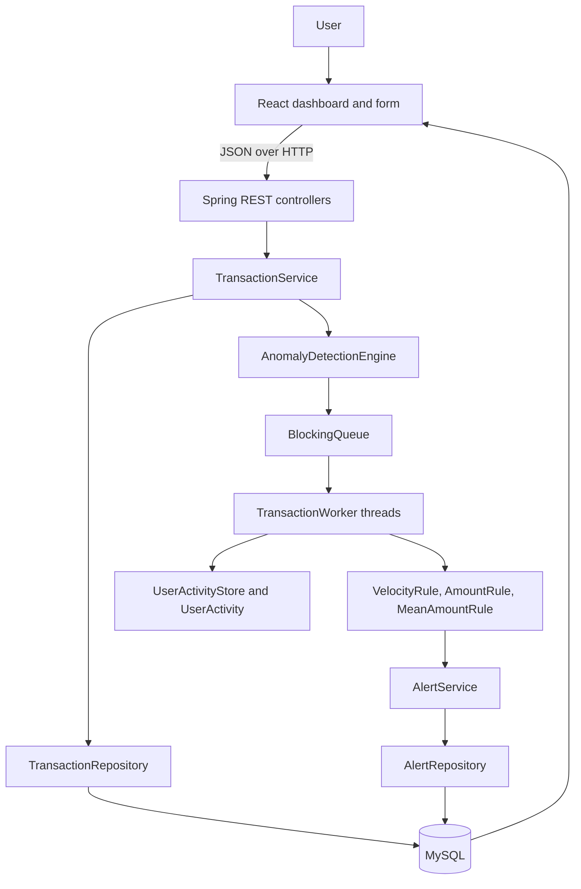

# upi-anomaly-detection

A Java Spring Boot application that monitors UPI transactions and detects unusual activity using velocity and transaction amount rules, with asynchronous processing and anomaly alerts.

# UPI Anomaly Detection Engine

A beginner-friendly Java project for submitting simulated UPI-style transactions through a React form, checking them with timestamp-based rules, and storing transactions and alerts in MySQL. The original Java producer-consumer engine remains the processing core.

This is an educational prototype. It is not connected to a real payment network, has not been load-tested, and does not use machine learning.

## Features

- React transaction form and monitoring dashboard.
- Spring Boot REST API with server-side validation and JSON error responses.
- JDBC repositories with prepared statements and environment-based database settings.
- Existing `BlockingQueue`, multiple worker threads, `ConcurrentHashMap`, per-user history, and poison-pill shutdown.
- Sliding 10-second velocity and amount rules, plus a 20-second above-mean amount rule.
- MySQL storage for transactions and alerts.
- Recent transaction and alert tables, including processing status.
- Excel export of alerts.

## Project tree

```text
.
|-- .env.example
|-- .gitignore
|-- pom.xml
|-- README.md
|-- frontend/
|   |-- index.html
|   |-- package.json
|   |-- package-lock.json
|   |-- vite.config.js
|   `-- src/
|       |-- App.jsx
|       |-- api.js
|       |-- main.jsx
|       |-- styles.css
|       `-- components/
|           |-- AlertTable.jsx
|           |-- Dashboard.jsx
|           |-- SummaryCards.jsx
|           |-- TransactionForm.jsx
|           `-- TransactionTable.jsx
|-- postman/
|   `-- UPI-Anomaly-Detection.postman_collection.json
|-- src/
|   |-- main/resources/
|   |   |-- application.properties
|   |   `-- schema.sql
|   `-- com/upianomaly/engine/
|       |-- Main.java
|       |-- EngineConfiguration.java
|       |-- alert/AlertService.java
|       |-- api/
|       |   |-- AlertController.java
|       |   |-- ApiDtos.java
|       |   |-- ApiExceptionHandler.java
|       |   |-- ApiExceptions.java
|       |   |-- DashboardController.java
|       |   |-- HealthController.java
|       |   `-- TransactionController.java
|       |-- core/
|       |   |-- AnomalyDetectionEngine.java
|       |   |-- PoisonPill.java
|       |   |-- TransactionWorker.java
|       |   |-- UserActivity.java
|       |   `-- UserActivityStore.java
|       |-- model/
|       |   |-- Alert.java
|       |   |-- AnomalyType.java
|       |   `-- Transaction.java
|       |-- repository/
|       |   |-- AlertRepository.java
|       |   |-- DatabaseConnection.java
|       |   `-- TransactionRepository.java
|       |-- rules/
|       |   |-- AmountRule.java
|       |   |-- AnomalyRule.java
|       |   |-- MeanAmountRule.java
|       |   `-- VelocityRule.java
|       |-- service/
|       |   |-- AlertExportService.java
|       |   |-- DashboardService.java
|       |   `-- TransactionService.java
|       `-- sim/TransactionSimulator.java
`-- test/
  `-- com/upianomaly/engine/
    |-- core/UserActivityOrderingTest.java
    |-- api/TransactionControllerTest.java
    |-- api/TransactionRequestTest.java
    |-- rules/MeanAmountRuleTest.java
    `-- rules/VelocityRuleTest.java
```

## Architecture



`POST /api/transactions` validates and stores the transaction, then submits it to the existing engine queue. The worker evaluates the rules and persists any alerts. Since processing is asynchronous, the POST response has status `202 Accepted` and transaction status `PROCESSING`; the dashboard refreshes periodically to show the final `NORMAL` or `ALERT` status.

### Main classes

| Class                                | Purpose and communication                                                                                 |
| ------------------------------------ | --------------------------------------------------------------------------------------------------------- |
| `Main`                               | Starts Spring Boot. It does not create normal transaction input.                                          |
| `TransactionController`              | Receives REST requests and calls `TransactionService`.                                                    |
| `TransactionService`                 | Validates/converts a request, persists it, then submits it to the engine.                                 |
| `TransactionRepository`              | Saves and reads transactions using JDBC.                                                                  |
| `AnomalyDetectionEngine`             | Owns the shared blocking queue and starts/stops worker threads.                                           |
| `TransactionWorker`                  | Takes a queued transaction, updates user history, runs rules, and marks processing complete.              |
| `UserActivityStore` / `UserActivity` | Store each user's recent timestamp-sorted transaction history safely.                                     |
| `AnomalyRule`                        | Shared interface implemented by each detection rule.                                                      |
| `VelocityRule`                       | Flags more than five transactions in the preceding 10 seconds.                                            |
| `AmountRule`                         | Preserves the original single-high-value and cumulative-amount checks.                                    |
| `MeanAmountRule`                     | Compares the current amount to the mean of previous transactions in the preceding 20 seconds.             |
| `AlertService`                       | Receives rule alerts and persists them through `AlertRepository`.                                         |
| `AlertRepository`                    | Saves alerts and supplies alert/dashboard views using JDBC.                                               |
| `TransactionSimulator`               | Remains as an optional demo/test data builder; it is not run by normal startup.                           |
| React components                     | `App` loads dashboard data; `TransactionForm` submits JSON; tables and summary cards display API results. |

## Anomaly rules

- **Velocity:** More than five transactions by the same user in the 10-second window produces `VELOCITY_ALERT`. Counts use the transaction timestamps, not sleeps or wall-clock processing timing.
- **Above mean:** The rule uses only earlier transactions strictly newer than the 20-second cutoff and no later than the current transaction. If there are no earlier transactions, it does not alert. It alerts only when the current amount is strictly greater than the mean; an equal amount does not alert.
- **Existing amount checks:** `AmountRule` continues to check a single amount above ₹50,000 and a 10-second cumulative total above ₹70,000. These thresholds are demonstration settings in `application.properties`.

The per-user history is synchronized and sorted by transaction timestamp. Submission sequence numbers make the workers evaluate one user's transactions in submission order, while different users can still be processed concurrently. This ordering is in-memory and single-process; a production multi-instance design would need durable per-user ordering.

## Technologies

- Java 17, Spring Boot, Spring Web, JDBC, Maven.
- MySQL and MySQL Connector/J.
- React, JavaScript, HTML, CSS, Vite, and browser `fetch()`.
- JUnit 5, Spring MockMvc, Mockito, and Apache POI for `.xlsx` export.

No MongoDB, cloud SDKs, Docker, Kubernetes, Kafka, Redis, C#, or .NET are used.

## MySQL setup

1. Start your local MySQL server and create/use a MySQL account.
2. Open `src/main/resources/schema.sql` in MySQL Workbench and execute it. It creates the `upi_anomaly_detection` database and the `transactions` and `alerts` tables.
3. Set connection values in the shell before starting the backend. Do not put your password in source control.

PowerShell example:

```powershell
$env:DB_URL = "jdbc:mysql://localhost:3306/upi_anomaly_detection?serverTimezone=UTC"
$env:DB_USERNAME = "root"
$env:DB_PASSWORD = "your-local-password"
```

The checked-in `.env.example` documents the variable names; Spring reads environment variables directly. The default URL and username are local-development defaults. The password default is empty, so set `DB_PASSWORD` if your local account requires one.

## Run the backend

Requires JDK 17+ and Maven:

```powershell
mvn spring-boot:run
```

The API listens on `http://localhost:8080`. `GET /api/health` checks the database connection and returns `UP` only when MySQL is reachable.

If port 8080 is already used, select another port before startup and point Vite's proxy to the same port:

```powershell
$env:SERVER_PORT = "8081"
mvn spring-boot:run
```

## Run the frontend

In another terminal:

```powershell
cd frontend
$env:VITE_API_TARGET = "http://localhost:8081" # only when the backend uses a non-default port
npm install
npm run dev
```

Open the Vite URL shown in the terminal, normally `http://localhost:5173`. Vite proxies `/api` requests to the backend. The dashboard includes loading, error, and empty states. The payment form uses a payer, a saved payee, and an amount; it creates a transaction ID and current timestamp automatically. The browser does not connect directly to MySQL. To exercise velocity detection, submit more than five payments for the same payer within 10 seconds.

## REST API and Postman

Import `postman/UPI-Anomaly-Detection.postman_collection.json` into Postman. Set its `baseUrl` collection variable to `http://localhost:8080`.

| Method | Endpoint                 | Result                                                           |
| ------ | ------------------------ | ---------------------------------------------------------------- |
| `GET`  | `/api/health`            | API and MySQL health                                             |
| `POST` | `/api/transactions`      | Validate, save, and enqueue a transaction; responds `202`        |
| `GET`  | `/api/transactions`      | List transactions with `NORMAL`, `ALERT`, or `PROCESSING` status |
| `GET`  | `/api/transactions/{id}` | Find a transaction by transaction ID                             |
| `GET`  | `/api/alerts`            | List alerts                                                      |
| `GET`  | `/api/alerts/{id}`       | Find an alert by numeric alert ID                                |
| `GET`  | `/api/dashboard`         | Totals and the 10 most recent transactions and alerts            |
| `GET`  | `/api/alerts/export`     | Download `alerts.xlsx`                                           |

Example POST body (timestamp should be ISO-8601; UTC with `Z` is recommended):

```json
{
  "transactionId": "TXN001",
  "userId": "user001",
  "beneficiaryId": "merchant001",
  "amount": 75000,
  "timestamp": "2026-10-05T10:30:00Z"
}
```

Example accepted response:

```json
{
  "transactionId": "TXN001",
  "userId": "user001",
  "beneficiaryId": "merchant001",
  "amount": 75000.0,
  "timestamp": "2026-10-05T10:30:00Z",
  "status": "PROCESSING"
}
```

Invalid input returns `400 Bad Request`; duplicate transaction IDs return `409 Conflict`; missing records return `404 Not Found`; database failures return `503 Service Unavailable`. Error bodies have `error` and `status` fields.

## Tests and build

```powershell
mvn test
cd frontend
npm run build
```

The Java tests cover the velocity and mean rules, API input validation, and transaction POST status/error responses. They do not require a database. Repository/database integration tests require a configured MySQL server and are not included yet.

## GitHub hygiene

`.gitignore` excludes `.env` files, `node_modules`, compiled classes, Maven output, frontend build output, and IDE metadata. Keep real database credentials out of README examples, tests, and commits.

## Technology Familiarity

- **MySQL** is the relational database implemented by this project. It stores transactions and their generated alerts.
- **MongoDB** is a document-oriented NoSQL database. It could suit flexible transaction or audit documents, but this project does not implement MongoDB.

## Cloud Deployment Concepts

This project has not been deployed to a cloud provider. As concepts to study, AWS could host a Java app on EC2, relational data in RDS, and files in S3. Azure equivalents to learn about include App Service, Azure SQL, and Blob Storage. No AWS or Azure SDK is included here.

## IIS

IIS (Internet Information Services) is Microsoft's web server used to host and manage web applications on Windows. This Java application is not configured for IIS, and this project does not claim hands-on IIS deployment.

## Beginner interview notes

1. **What does the app do?** It accepts UPI-style transactions through a React form, stores them in MySQL, and checks them with simple timestamp-based rules.
2. **How does a transaction flow through the app?** React sends JSON to a controller; the service validates and stores it, then submits it to the engine queue; a worker applies rules and stores any alert.
3. **Why use a `BlockingQueue`?** It separates API submission from rule processing, and `take()` waits for work without busy-waiting.
4. **Why keep multiple worker threads?** Different users can be processed concurrently. Transactions from one user wait for their sequence so velocity and amount rules see a consistent history.
5. **What is a poison pill?** It is a special queue value that tells one worker to exit during a graceful shutdown.
6. **How does the velocity rule work?** It counts a user's transactions based on their timestamps in a sliding 10-second window and alerts above five.
7. **How does the mean rule work?** It averages prior transactions newer than the 20-second cutoff and alerts only if the current amount is greater than that average.
8. **Why use an `AnomalyRule` interface?** Each rule follows the same method, so another clear rule can be added without rewriting the worker loop.
9. **Is this machine learning?** No. It is explainable, threshold-based rule logic; it does not train or run a model.
10. **What would you improve for production?** Add database-backed integration tests, durable per-user ordering across app instances, connection pooling, load testing, monitoring, and threshold calibration.

## Simple framework concepts used

- `@SpringBootApplication` marks the app entry point and starts Spring Boot.
- `@RestController` maps Java methods to HTTP endpoints; `@GetMapping` and `@PostMapping` select the HTTP method and path.
- `@PathVariable` reads an ID from a URL; `@RequestBody` converts request JSON into a Java object.
- `@Service` holds application flow; `@Repository` performs data access. Constructor parameters let Spring provide the needed objects (dependency injection).
- HTTP codes communicate outcomes: `202` means accepted for asynchronous processing, `400` invalid input, `404` missing data, `409` duplicate ID, and `503` unavailable database/service.
- React components return JSX, which describes UI. `useState` stores changing values, `useEffect` loads and refreshes dashboard data, props pass data or callbacks to child components, event handlers process form actions, and `fetch()` calls the REST API.
- Conditional rendering shows loading, error, empty, or populated states based on current React state.
